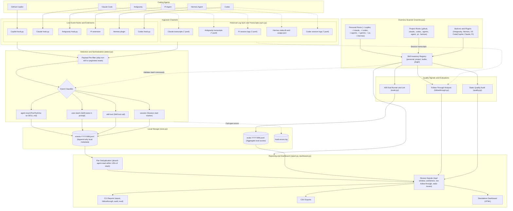
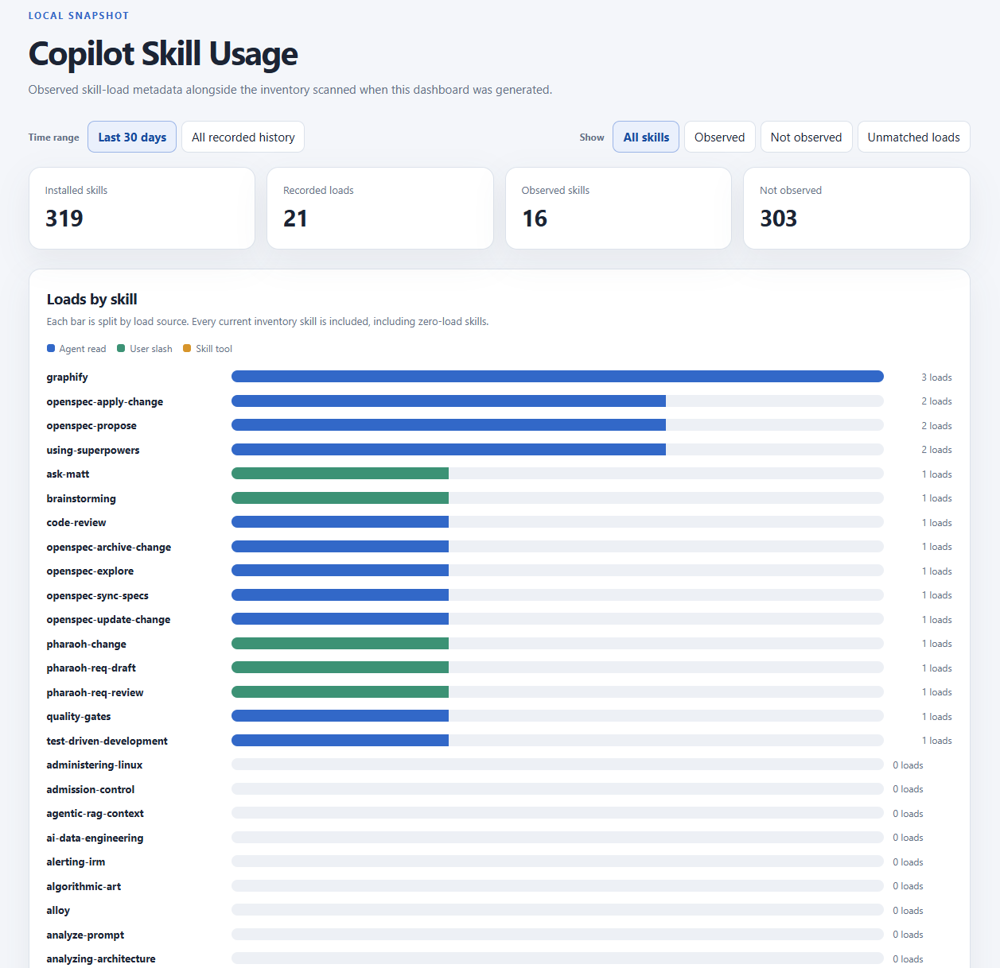

# Agent Skill Usage Tracker

Local-only tracker and review toolkit for coding agent skills across **GitHub Copilot**, **Claude**, **Antigravity**, **Pi Agent**, **Hermes Agent**, and **Codex**. Tracks which skills agents load across sessions and complements load counts with on-demand **follow-through** transcript analysis, **static quality audits** (`SKILL.md` frontmatter, trigger descriptions, progressive disclosure, broken links, and unreferenced support files), and **A/B skill evaluations**. Load counts, follow-through rates, and static checks are review signals for maintaining your skill library—not ground-truth evaluations of task outcomes unless paired with explicit A/B eval suites. See [docs/design.md](docs/design.md) and [GLOSSARY.md](GLOSSARY.md).

## Supported Agents

- **GitHub Copilot** (`copilot`): Scans `~/.copilot/skills`, `~/.claude/skills`, `~/.agents/skills`, project `.github/skills`, `.claude/skills`, `.agents/skills`, and Copilot/VS Code plugin stores; records live loads via `hook.py` and supports static `audit` checks and `eval` suites.
- **Claude** (`claude`): Scans `~/.claude/skills`, `~/.agents/skills`, `~/.claude/plugins` (`plugin:claude/<pkg>`), and project `.claude/skills` & `.agents/skills`; syncs historical session transcripts from `~/.claude/projects/**/*.jsonl`, analyzes post-load follow-through, and supports live hooks in `~/.claude/settings.json`.
- **Antigravity** (`antigravity`): Scans `~/.gemini/config/skills`, `~/.gemini/config/plugins/*/skills`, `~/.gemini/antigravity*/builtin/skills` (`builtin:antigravity`), and project `.agent/skills`; syncs historical transcripts from `~/.gemini/antigravity*/brain/*/.system_generated/logs/transcript.jsonl`, analyzes post-load follow-through, and supports live hooks in `~/.gemini/config/hooks.json`.
- **Pi Agent** (`pi`): Scans `~/.pi/agent/skills`, `~/.pi/agent/git` & `~/.pi/agent/npm` (`plugin:pi/<pkg>`), and project `.pi/skills`; syncs session logs from `~/.pi/agent/sessions/**/*.jsonl`, analyzes post-load follow-through, and supports a live extension in `~/.pi/agent/extensions/skill-usage.ts`.
- **Hermes Agent** (`hermes`): Scans `~/.hermes/skills` (`builtin:hermes` for bundled skills in `.bundled_manifest`, `personal` for custom skills), `~/.hermes/plugins/*/skills`, and project `.hermes/skills`; syncs from `~/.hermes/state.db` and `~/.hermes/skills/.usage.json`, analyzes post-load follow-through, and supports a live plugin in `~/.hermes/plugins/skill-usage/`.
- **Codex** (`codex`): Scans `~/.codex/skills`, project `.codex/skills`, and shared `.agents/skills`; syncs historical sessions from `~/.codex/`, analyzes post-load follow-through, and supports live hooks in `~/.codex/hooks.json`.

## Architecture



### How It Works

1. **Dual-Path Ingestion**:
   - **Live Hooks (`hook.py`)**: Intercepts events (`SessionStart`, `UserPromptSubmit`, `PreToolUse`, `PostToolUse`) in real time across agents. Completely non-blocking and fail-open.
   - **Historical Sync (`tracker/sync.py`)**: Parses transcripts and state databases across Claude, Antigravity, Pi Agent, Hermes Agent, and Codex. Sync recovers pre-hook history, unhooked agent sessions, missed events, and events not exposed to live hooks (such as Antigravity slash commands and Hermes `.usage.json`). An automated 30-second timestamp deduplication window prevents duplicate events when both hooks and sync are active.
2. **Detection & Classification (`tracker/detect.py`)**:
   - `agent-read`: Tool read calls accessing a `SKILL.md` inside a skill directory (including Antigravity `Path` arguments, while skipping paginated continuation reads such as `StartLine > 1` or `ByteOffset > 0`).
   - `user-slash`: User prompts starting with `/<skill>` or `/<plugin> <skill>` matching known skill names.
   - `skill-tool`: Direct calls through dedicated skill-invocation tools (`Skill`, `skill_view` without a support `file_path`, etc.).
   - `session`: Session starts to calculate baseline session counts and identify sessions where no skills were loaded.
3. **Local Storage (`tracker/store.py`)**:
   - Appends compact JSON lines into monthly files (`~/.copilot/skill-usage/data/events-YYYY-MM.jsonl` and `evals-YYYY-MM.jsonl`).
   - Stores metadata only (`ts`, `session_id`, `workspace` folder name, `agent`, `skill`, `path`, `source`, and aggregate eval scores). Never stores prompt contents, model reasoning, or file contents.
4. **Inventory Discovery (`tracker/inventory.py`)**:
   - Scans personal dirs, workspace project roots, plugin directories, and built-ins.
   - Tracks each copy with its scope tag (`personal`, `project`, `builtin:<agent>`, `plugin:<pkg>`) and aggregates duplicate skill copies without double-counting.
5. **Follow-Through Analysis (`tracker/followthrough.py`)**:
   - Inspects session transcripts on demand across **Antigravity**, **Claude**, **Pi Agent**, **Hermes Agent**, and **Codex** without writing persistent state (unless `--csv` is requested).
   - Measures whether, after a skill loads in a session (`agent-read`, `user-slash`, or `skill-tool`), the agent reads or executes any non-metadata support file inside that skill's folder or any existing local file linked from its `SKILL.md` (including `skill_view` reference/script reads). Packaging and metadata files (`README*`, `LICENSE*`, `CHANGELOG*`, `agents/*`, `package.json`, `pyproject.toml`, `plugin.json`, `manifest.json`) are excluded.
   - Scores only loads of skill copies that actually have support or linked files, and flags low follow-through (`< 30%` across `>= 5` scored sessions by default) as a review signal—not proof of low quality, since a task may only need `SKILL.md`. Markdown output never contains filesystem paths.
6. **Static Quality Audit (`tracker/quality.py`)**:
   - Evaluates all inventoried skill copies directly on disk using Python stdlib only, working even with zero recorded sessions and for `SKILL.md`-only skills.
   - Checks YAML frontmatter (`missing-frontmatter`, `missing-name`, `missing-description`), trigger description quality (`weak-description`, `overlong-description` > 1024 chars), progressive disclosure (`oversized-skill-md` > 500 lines), local markdown references (`broken-link`), and support file discoverability (`unreferenced-file` info findings). Markdown output and dashboard payloads never contain host filesystem paths.
7. **Skill Evaluations & Lint (`tracker/evals.py`)**:
   - **Eval Discovery**: Looks for user-authored suites in `~/.copilot/skill-usage/evals/<skill>.json` (`$SKILL_USAGE_EVALS`) first, then provider-bundled `evals/evals.json` (or `evals.json`) inside each skill folder.
   - **A/B Runner**: Runs each prompt with the skill instructions (`with-skill`) and without (`baseline`) in isolated temp directories using a local agent CLI (`claude`, `codex`, `copilot`, `gemini`, `pi`, `hermes`) or `--runner-cmd`, grading deterministic assertions (`contains`, `not_contains`, `regex`, `file_exists`, `file_contains`, `json_valid`, `command`) or an optional `--judge-cmd`.
   - **Static Health Lint**: Quick `eval --lint-only` checks for `SKILL.md` frontmatter (`name`, `description`) and relative links alongside bundled eval discovery.
8. **Deduplication, Reporting & Dashboard (`tracker/report.py`, `tracker/dashboard.py`)**:
   - **Slash-Read Pairing**: A `/skill` invocation followed by an `agent-read` of the same skill within 120 seconds in the same session is merged into a single counted load in reports.
   - **Evaluation Thresholds & Usefulness**: A skill with zero observed loads is labeled `insufficient data` until tracking covers at least 30 days and 20 sessions before being flagged as a `review candidate`. When eval scores are recorded, load counts and baseline lift (`benefit_delta`) are combined into `high-value`, `under-triggered`, `low-benefit`, `neutral`, or `review-candidate`.
   - **Unified Dashboard**: The standalone HTML snapshot combines load counts with per-skill follow-through rates, static quality status/issue codes, A/B eval scores & benefit deltas, and **Needs attention** / **Evaluated** filters alongside agent, time-range, and observation filters.

## Use

```bash
# Sync usage from Claude, Antigravity, Pi Agent, Hermes Agent, and Codex logs (optional: report & dashboard auto-sync by default)
python3 skill_usage.py sync
python3 skill_usage.py sync --agent codex

# Print a unified or agent-filtered load report (automatically syncs default data dir unless --no-sync is given)
python3 skill_usage.py report --days 30
python3 skill_usage.py report --days 30 --agent codex
python3 skill_usage.py report --days 90 --csv report.csv --workspace /path/to/project

# Analyze post-load follow-through on skill support/linked files across transcripts (stores nothing unless --csv is passed)
python3 skill_usage.py followthrough
python3 skill_usage.py followthrough --days 30 --agent antigravity
python3 skill_usage.py followthrough --min-sessions 5 --low-rate 0.3 --workspace /path/to/project --csv followthrough.csv

# Audit static SKILL.md and support-file quality across all inventoried skills
python3 skill_usage.py audit
python3 skill_usage.py audit --issues-only --agent claude
python3 skill_usage.py audit --workspace /path/to/project --csv audit.csv

# Generate the standalone HTML dashboard with load counts, follow-through rates, static quality checks, and eval scores
python3 skill_usage.py dashboard
python3 skill_usage.py dashboard --agent codex --output codex-dashboard.html
python3 skill_usage.py dashboard --data-dir data --workspace /path/to/project --output dashboard.html

# Optional: install live hooks/extensions for Claude, Antigravity, Pi Agent, Hermes Agent, and Codex
python3 skill_usage.py install-hooks
python3 skill_usage.py install-hooks --agent codex

# Static health lint across installed skills (no LLM calls)
python3 skill_usage.py eval --lint-only

# Run A/B evals (with-skill vs. baseline) for a skill or all skills with evals.json
python3 skill_usage.py eval --skill my-skill --runner claude
python3 skill_usage.py eval --all --dry-run

# Or record an external/manual eval score into usage tracking
python3 skill_usage.py eval-record --skill my-skill --score 0.9 --baseline 0.4 --cases 10
```

> **Note on Manual Sync vs. Live Hooks:**
>
> - `report` and `dashboard` automatically run `sync` when using the default data directory, so running `python3 skill_usage.py sync` manually before reporting is **not required** (use `--no-sync` to skip auto-sync, or `--sync` to force sync when `--data-dir` is specified).
> - `followthrough` and `audit` inspect local session logs and skill directories directly on demand and do not read or write the `events-YYYY-MM.jsonl` store.
> - Running `python3 skill_usage.py sync` directly remains **required and recommended** for:
>   1. Synchronizing into custom `--data-dir` locations (auto-sync is disabled when `--data-dir` is specified unless `--sync` is passed).
>   2. Standalone periodic sync jobs or background scripts without rendering reports or dashboards.
>   3. Inspecting synchronization feedback (prints newly synced counts per agent).
>   4. Backfilling historical events from sessions run before hooks were installed, or capturing events from unhooked agents and events not exposed to live hooks (such as Antigravity prompt submissions).

The dashboard writes a local standalone HTML snapshot (`skill-usage-dashboard.html` in the current directory by default). Open it directly in a browser and use the **Agent** selector (`All agents`, `Copilot`, `Claude`, `Antigravity`, `Pi Agent`, `Hermes Agent`, `Codex`) or **Show** filters (`All skills`, `Observed`, `Not observed`, `Needs attention`, `Evaluated`, `Exclude built-in`, `Unmatched loads`) to inspect specific agents, custom skills, static quality warnings, low follow-through skills, and evaluated skills.
`--workspace` can be repeated to add project skill roots, `--data-dir` selects the event directory, `--agent` filters by agent (`{all,copilot,claude,antigravity,pi,hermes,codex}` for `report`, `audit`, `eval`, `eval-record`, and `dashboard`; `{all,antigravity,claude,pi,hermes,codex}` for `followthrough`), and `--output` selects the HTML path. Markdown reports (`report`, `followthrough`, `audit`) and the dashboard contain skill names and aggregate metadata only—never skill contents or host filesystem paths.

**Interpretation caveats**: Inventory reflects the time a report or dashboard is generated. Load counts, follow-through rates, and static quality findings are review signals rather than ground-truth task outcome evaluations: “not observed” is not proof a skill is unnecessary, low follow-through can occur when `SKILL.md` alone was sufficient for the task, and static checks verify structural hygiene rather than runtime effectiveness.

A slash invocation of a skill such as `/grill-me` is followed by the agent reading the skill's `SKILL.md`. The report merges that read into the slash load when it is in the same session within 120 seconds, so one invocation counts once. Raw events keep both records.

## Dashboard



## Data

Events are stored in `~/.copilot/skill-usage/data/events-YYYY-MM.jsonl` and eval summaries in `evals-YYYY-MM.jsonl` by default (or `$SKILL_USAGE_DATA` / `--data-dir`), containing metadata only: time, session ID, workspace folder name, agent, skill, load source, and aggregate eval scores (never prompts or model outputs). User-authored eval suites live in `~/.copilot/skill-usage/evals/<skill>.json` (or `$SKILL_USAGE_EVALS`). Hook failures are logged by error type in `hook-errors.log`. Nothing leaves this machine and nothing is deleted automatically.

## Disable

Remove the relevant hook configuration if installed:

- Copilot: `~/.copilot/hooks/skill-usage.json`
- Claude: `"hooks"` entries for `hook.py` in `~/.claude/settings.json`
- Antigravity: `"skill-usage"` entry in `~/.gemini/config/hooks.json`
- Pi Agent: `~/.pi/agent/extensions/skill-usage.ts`
- Hermes Agent: `~/.hermes/plugins/skill-usage/`
- Codex: `~/.codex/hooks.json`

## Uninstall and erase data

Delete the hook files above, then delete the `~/.copilot/skill-usage` folder.

## Tests

```bash
python3 -m unittest discover -s tests -t . -v
```
