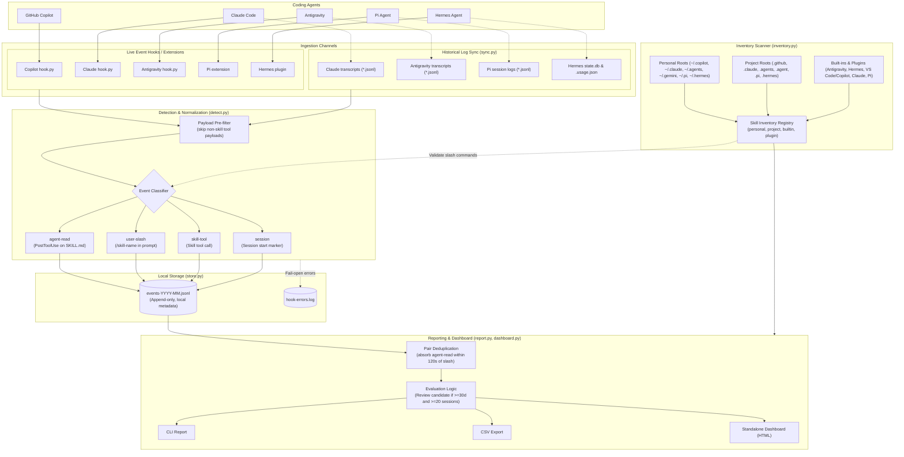
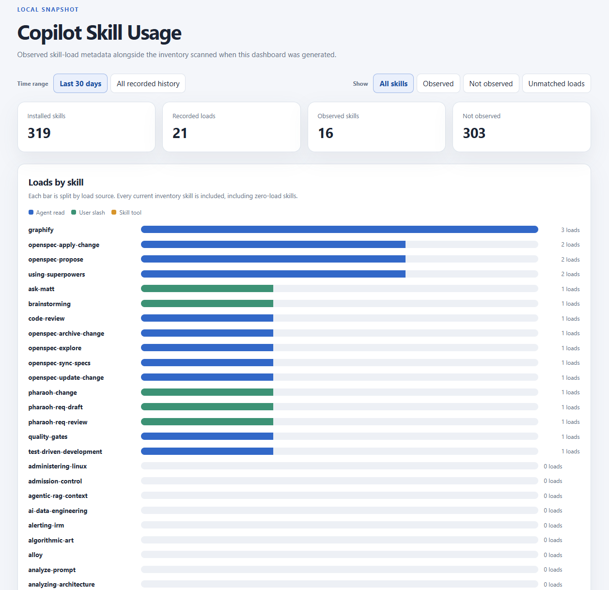

# Agent Skill Usage Tracker

Local-only tracker of which skills your coding agents (**GitHub Copilot**, **Claude**, **Antigravity**, **Pi Agent**, and **Hermes Agent**) load across sessions. Can be used as a reference to review and clean up skills that have not been observed over time. See [docs/design.md](docs/design.md) and [GLOSSARY.md](GLOSSARY.md).

## Supported Agents

- **GitHub Copilot** (`copilot`): Scans `~/.copilot/skills`, `~/.claude/skills`, `~/.agents/skills`, project `.github/skills`, `.claude/skills`, `.agents/skills`, and Copilot/VS Code plugin stores; records live loads via `hook.py`.
- **Claude** (`claude`): Scans `~/.claude/skills`, `~/.agents/skills`, `~/.claude/plugins` (`plugin:claude/<pkg>`), and project `.claude/skills` & `.agents/skills`; syncs historical session transcripts from `~/.claude/projects/**/*.jsonl` and supports live hooks in `~/.claude/settings.json`.
- **Antigravity** (`antigravity`): Scans `~/.gemini/config/skills`, `~/.gemini/config/plugins/*/skills`, `~/.gemini/antigravity*/builtin/skills` (`builtin:antigravity`), and project `.agent/skills`; syncs historical transcripts from `~/.gemini/antigravity*/brain/*/.system_generated/logs/transcript.jsonl` and supports live hooks in `~/.gemini/config/hooks.json`.
- **Pi Agent** (`pi`): Scans `~/.pi/agent/skills`, `~/.pi/agent/git` & `~/.pi/agent/npm` (`plugin:pi/<pkg>`), and project `.pi/skills`; syncs session logs from `~/.pi/agent/sessions/**/*.jsonl` and supports a live extension in `~/.pi/agent/extensions/skill-usage.ts`.
- **Hermes Agent** (`hermes`): Scans `~/.hermes/skills` (`builtin:hermes` for bundled skills in `.bundled_manifest`, `personal` for custom skills), `~/.hermes/plugins/*/skills`, and project `.hermes/skills`; syncs from `~/.hermes/state.db` and `~/.hermes/skills/.usage.json` and supports a live plugin in `~/.hermes/plugins/skill-usage/`.

## Architecture



### How It Works

1. **Dual-Path Ingestion**:
   - **Live Hooks (`hook.py`)**: Intercepts events (`SessionStart`, `UserPromptSubmit`, `PreToolUse`, `PostToolUse`) in real time. Completely non-blocking and fail-open.
   - **Historical Sync (`tracker/sync.py`)**: Parses historical transcripts and state databases across Claude, Antigravity, Pi Agent, and Hermes Agent without needing hooks installed ahead of time.
2. **Detection & Classification (`tracker/detect.py`)**:
   - `agent-read`: Tool read calls accessing a `SKILL.md` inside a skill directory (skips pagination/continuation calls).
   - `user-slash`: User prompts starting with `/<skill>` or `/<plugin> <skill>` matching known skill names.
   - `skill-tool`: Direct calls through dedicated skill-invocation tools.
   - `session`: Session starts to calculate baseline session counts and identify sessions where no skills were loaded.
3. **Local Storage (`tracker/store.py`)**:
   - Appends compact JSON lines into monthly files (`~/.copilot/skill-usage/data/events-YYYY-MM.jsonl`).
   - Stores metadata only (`ts`, `session_id`, `workspace` folder name, `agent`, `skill`, `path`, `source`). Never stores prompt contents, model reasoning, or file contents.
4. **Inventory Discovery (`tracker/inventory.py`)**:
   - Scans personal dirs, workspace project roots, plugin directories, and built-ins.
   - Tracks each copy with its scope tag (`personal`, `project`, `builtin:<agent>`, `plugin:<pkg>`) and aggregates duplicate skill copies without double-counting.
5. **Deduplication & Reporting (`tracker/report.py`, `tracker/dashboard.py`)**:
   - **Slash-Read Pairing**: A `/skill` invocation followed by an `agent-read` of the same skill within 120 seconds in the same session is merged into a single counted load in reports.
   - **Evaluation Thresholds**: A skill with zero observed loads is labeled `insufficient data` until tracking covers at least 30 days and 20 sessions before being flagged as a `review candidate`.

## Use

```bash
# Sync historical usage from Claude, Antigravity, Pi Agent, and Hermes Agent logs
python3 skill_usage.py sync

# Print a unified or agent-filtered report
python3 skill_usage.py report --days 30
python3 skill_usage.py report --days 30 --agent claude
python3 skill_usage.py report --days 90 --csv report.csv --workspace /path/to/project

# Generate the standalone HTML dashboard (includes Agent selector & Exclude built-in filter)
python3 skill_usage.py dashboard
python3 skill_usage.py dashboard --data-dir data --workspace /path/to/project --output dashboard.html

# Optional: install live hooks/extensions for Claude, Antigravity, Pi Agent, and Hermes Agent
python3 skill_usage.py install-hooks
```

The dashboard writes a local standalone HTML snapshot (`skill-usage-dashboard.html` in the current directory by default). Open it directly in a browser and use the **Agent** selector (`All agents`, `Copilot`, `Claude`, `Antigravity`, `Pi Agent`, `Hermes Agent`) or **Show -> Exclude built-in** to inspect specific agents and custom skills.
`--workspace` can be repeated to add project skill roots, `--data-dir` selects the event directory, `--agent` filters by agent, and `--output` selects the HTML path. The dashboard contains skill names and aggregate usage metadata, not skill contents or filesystem paths. Inventory reflects the time the dashboard is generated; “not observed” is not evidence that a skill is unnecessary, and an unmatched load only means there is no current inventory match.

A slash invocation of a skill such as `/grill-me` is followed by the agent reading the skill's `SKILL.md`. The report merges that read into the slash load when it is in the same session within 120 seconds, so one invocation counts once. Raw events keep both records.

## Dashboard


## Data

Events are stored in `~/.copilot/skill-usage/data/events-YYYY-MM.jsonl` by default (or `$SKILL_USAGE_DATA` / `--data-dir`), containing metadata only: time, session ID, workspace folder name, agent, skill, and load source. Hook failures are logged by error type in `hook-errors.log`. Nothing leaves this machine and nothing is deleted automatically.

## Disable

Remove the relevant hook configuration if installed:
- Copilot: `~/.copilot/hooks/skill-usage.json`
- Claude: `"hooks"` entries for `hook.py` in `~/.claude/settings.json`
- Antigravity: `"skill-usage"` entry in `~/.gemini/config/hooks.json`
- Pi Agent: `~/.pi/agent/extensions/skill-usage.ts`
- Hermes Agent: `~/.hermes/plugins/skill-usage/`

## Uninstall and erase data

Delete the hook files above, then delete the `~/.copilot/skill-usage` folder.

## Tests

```bash
python3 -m unittest discover -s tests -t . -v
```

