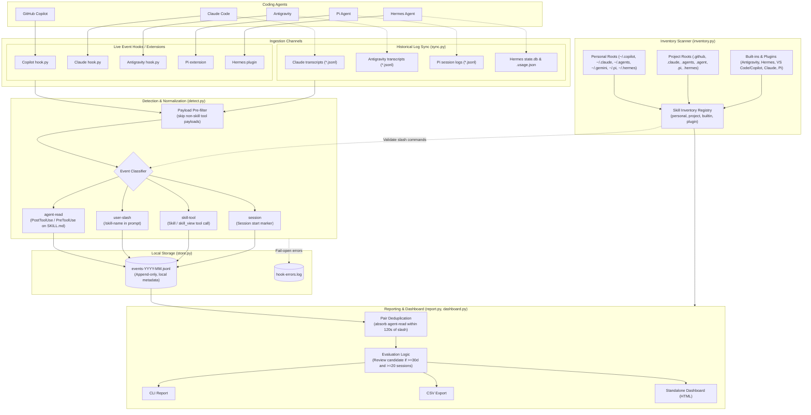
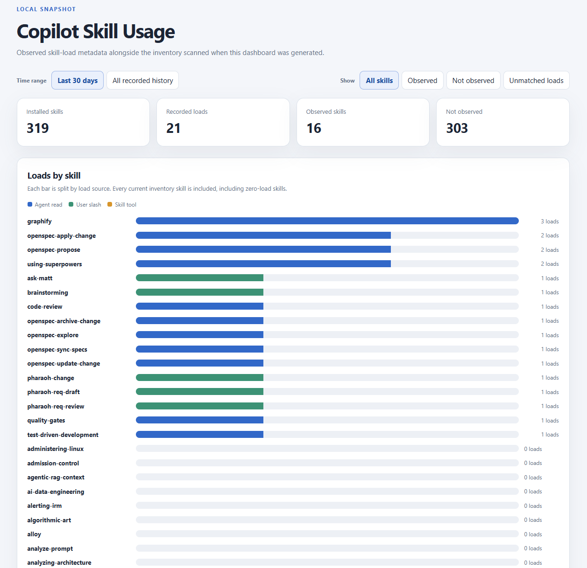
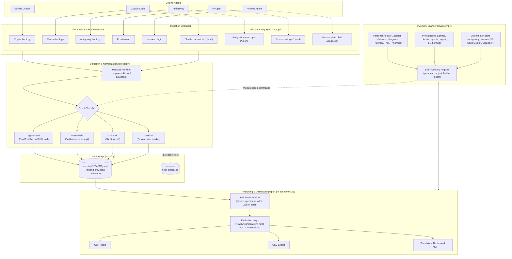

# Agent Skill Usage Tracker

Local-only tracker of which skills your coding agents (**GitHub Copilot**, **Claude Code**, **Antigravity**, **Pi Agent**, and **Hermes Agent**) load across sessions. Can be used as a reference to review and clean up skills that have not been observed over time. See [docs/design.md](docs/design.md) and [GLOSSARY.md](GLOSSARY.md).

## Supported Agents

Originally built for GitHub Copilot in VS Code, the tracker now provides a unified multi-agent pipeline across five coding agents:

| Agent | Agent ID | Inventory Locations Scanned | Live Hook / Extension | Historical Sync Source |
| :--- | :--- | :--- | :--- | :--- |
| **GitHub Copilot** | `copilot` | `~/.copilot/skills`, `~/.claude/skills`, `~/.agents/skills`, project `.github/skills`, `.claude/skills`, `.agents/skills`, `~/.copilot/installed-plugins`, `~/.vscode/agent-plugins` | `~/.copilot/hooks/skill-usage.json` → `hook.py` | — *(live hook only)* |
| **Claude Code** | `claude` | `~/.claude/skills`, `~/.agents/skills`, `~/.claude/plugins` (`plugin:claude/<pkg>`), project `.claude/skills`, `.agents/skills` | `~/.claude/settings.json` → `hook.py --agent claude` | `~/.claude/projects/**/*.jsonl` |
| **Antigravity** | `antigravity` | `~/.gemini/config/skills`, `~/.agents/skills`, `~/.gemini/config/plugins/*/skills` (`plugin:antigravity/<pkg>`), `~/.gemini/antigravity*/builtin/skills` (`builtin:antigravity`), project `.agent/skills`, `.agents/skills` | `~/.gemini/config/hooks.json` → `hook.py` | `~/.gemini/antigravity*/brain/*/.system_generated/logs/transcript.jsonl` |
| **Pi Agent** | `pi` | `~/.pi/agent/skills`, `~/.agents/skills`, `~/.pi/agent/git` & `~/.pi/agent/npm` (`plugin:pi/<pkg>`), project `.pi/skills`, `.agents/skills` | `~/.pi/agent/extensions/skill-usage.ts` → `hook.py` | `~/.pi/agent/sessions/**/*.jsonl` |
| **Hermes Agent** | `hermes` | `~/.hermes/skills` (`builtin:hermes` via `.bundled_manifest` or `personal`), `~/.agents/skills`, `~/.hermes/plugins/*/skills` (`plugin:hermes/<pkg>`), project `.hermes/skills`, `.agents/skills` | `~/.hermes/plugins/skill-usage/` → `hook.run()` | `~/.hermes/state.db` & `~/.hermes/skills/.usage.json` |

## Architecture



## How Multi-Agent Support Works

### 1. Multi-Agent Inventory & Shared Skill Attribution (`tracker/inventory.py`)

Each discovered `SKILL.md` is represented as a `SkillCopy(name, path, source, agents)` entry:
- **Agent-Specific & Shared Roots**:
  - `~/.agents/skills` and project `.agents/skills` are shared across all five agents (`copilot`, `claude`, `antigravity`, `pi`, `hermes`).
  - `~/.claude/skills` and project `.claude/skills` are shared between `copilot` and `claude`.
  - Agent-specific directories (such as `~/.gemini/config/skills`, `.agent/skills`, `~/.pi/agent/skills`, `.pi/skills`, `~/.hermes/skills`, `.hermes/skills`, `~/.copilot/skills`, `.github/skills`) map to their respective agents.
  - When the same physical `SKILL.md` is discovered through multiple rules, its `agents` tuple is merged in place without inflating copy counts.
- **Scope & Plugin Classification**:
  - Copies are tagged as `personal`, `project`, `plugin:<store>/<pkg>`, or `builtin:<agent>`.
  - Plugin scanners cover Copilot/VS Code (`~/.copilot/installed-plugins`, `~/.vscode/agent-plugins`), Claude (`~/.claude/plugins/installed_plugins.json`, `cache/`, and plugin subdirectories), Antigravity (`~/.gemini/config/plugins/*/skills`), Pi Agent (`~/.pi/agent/git` and `~/.pi/agent/npm`), and Hermes (`~/.hermes/plugins/*/skills`).
  - Built-in skills are tagged as `builtin:antigravity` (`~/.gemini/antigravity*/builtin/skills`) or `builtin:hermes` (skills listed in `~/.hermes/skills/.bundled_manifest`, distinguishing them from custom `personal` skills in `~/.hermes/skills`).

### 2. Dual-Channel Ingestion (`hook.py` & `tracker/sync.py`)

Agents are tracked via **live hooks/extensions**, **historical log sync**, or **both simultaneously**:

- **Live Event Hooks & Extensions (`hook.py`, `python3 skill_usage.py install-hooks`)**:
  - **GitHub Copilot**: Runs `hook.py` on `SessionStart`, `UserPromptSubmit`, and `PostToolUse` via `~/.copilot/hooks/skill-usage.json`.
  - **Claude Code**: Runs `hook.py --agent claude` on `SessionStart`, `UserPromptSubmit`, and `PostToolUse` (matcher `Read|Skill`) in `~/.claude/settings.json`.
  - **Antigravity**: Runs `hook.py` on `PreInvocation` and `PreToolUse` (matcher `view_file`) in `~/.gemini/config/hooks.json`. When `hook.py` detects `conversationId` in the input, it returns `{"decision": "allow"}` (for tool calls) or `{}` so Antigravity is never blocked.
  - **Pi Agent**: Installs `~/.pi/agent/extensions/skill-usage.ts`, which listens to `session_start`, `input`, and `tool_call` (`read`) and spawns `hook.py` asynchronously with `agent: "pi"`.
  - **Hermes Agent**: Installs `~/.hermes/plugins/skill-usage/` (`plugin.yaml` and `__init__.py`), registering `on_session_start` and `post_tool_call` (`skill_view`, `read_file`, `view_file`, `read`) to call `hook.run()` in-process with `agent: "hermes"`.
- **Historical Log & Database Sync (`tracker/sync.py`, `python3 skill_usage.py sync`)**:
  - Backfills historical sessions for Claude, Antigravity, Pi Agent, and Hermes Agent without requiring live hooks to have been installed ahead of time. `report` and `dashboard` automatically run a sync on the default data directory unless `--no-sync` is passed.
  - **Claude Code (`collect_claude_events`)**: Scans `~/.claude/projects/**/*.jsonl` for session starts, user prompts (including `<command-name>` XML wrappers), and assistant `tool_use` / `toolCall` items.
  - **Antigravity (`collect_antigravity_events`)**: Scans `transcript.jsonl` under `~/.gemini/{antigravity,antigravity-ide,antigravity-cli}/brain/*`, extracting `<USER_REQUEST>` blocks from `USER_INPUT` steps and `tool_calls` from `PLANNER_RESPONSE` steps.
  - **Pi Agent (`collect_pi_events`)**: Scans `~/.pi/agent/sessions/**/*.jsonl` for `session` headers, `/skill:<name>` or `/<skill>` prompts, and assistant `toolCall` entries.
  - **Hermes Agent (`collect_hermes_events`)**: Queries `~/.hermes/state.db` (`sessions` and active `messages` tables in read-only SQLite mode) for `[IMPORTANT: The user has invoked the "..." skill]` banners, slash prompts, and assistant `function` tool calls, then falls back to `~/.hermes/skills/.usage.json` for skills with recorded counts not present in `state.db`.
- **Idempotency & Cross-Channel Deduplication**:
  - `sync_events()` deduplicates against existing events by `(agent, session_id)` for sessions, by exact key `(agent, session_id, type, ts, skill, source)`, and within a 5-second window (`_LIVE_HOOK_SLACK_SECONDS = 5`) so events already recorded by a live hook are not duplicated when `sync` later parses the session transcript. Repeated reads of the same skill within 60 seconds during transcript sync (`_DEDUP_READ_SECONDS = 60`) are also collapsed.

### 3. Cross-Agent Detection & Normalization (`tracker/detect.py`)

Both live hook events and synthetic sync events flow through `detect.detect()`, which normalizes heterogeneous payloads into a common schema (`type`, `ts`, `session_id`, `workspace`, `agent`, `skill`, `path`, `source`):

- **Agent Resolution (`_infer_agent`)**: Uses explicit `event["agent"]` (or `--agent`), infers `antigravity` from `conversationId`, infers `claude` when `transcript_path` contains `.claude`, and defaults untagged legacy events to `copilot`.
- **`agent-read`**: Matches read tools across agents (`read_file`, `Read`, `view`, `readFile`, `view_file`, `read`) and path keys (`filePath`, `file_path`, `path`, `AbsolutePath`, stripping extra quotes) targeting a `SKILL.md` inside a `skills` directory. Skips paginated continuation calls (`StartLine > 1` or `offset > 1`) and excluded directories (`.archive`, `.curator_backups`, `.hub`).
- **`skill-tool`**: Matches dedicated skill tools (`Skill`, `skill`, `skill_view`) and reads `skill` or `name` (ignoring `skill_view` calls that specify a secondary `file_path`).
- **`user-slash`**: Matches user prompts starting with `/<skill>`, `/<plugin>:<skill>`, `/<plugin> <skill>`, Claude `<command-name>` tags, Pi `/skill:<name>` commands, and Hermes invocation banners against known skill names.
- **`session`**: Records session start markers (`SessionStart`, Antigravity `invocationNum == 1`, or synced session headers) to establish baseline session counts and workspace folder names (`cwd` or `workspacePaths[0]`).

### 4. Storage, Deduplication & Reporting (`store.py`, `report.py`, `dashboard.py`)

- **Local Storage (`tracker/store.py`)**: Appends compact JSON lines into monthly files (`~/.copilot/skill-usage/data/events-YYYY-MM.jsonl`). Stores metadata only (`ts`, `session_id`, `workspace` folder name, `agent`, `skill`, `path`, `source`)—never prompt text, model reasoning, or file contents.
- **Slash-Read Pairing (`tracker/report.py`)**: A `/skill` invocation followed by an `agent-read` of the same skill within 120 seconds in the same session is merged into a single counted load in reports and dashboards while preserving both raw records.
- **Evaluation Thresholds & Agent Views**: A skill with zero observed loads is labeled `insufficient data` until tracking covers at least 30 days and 20 sessions, after which it is flagged as a `review candidate`. CLI reports include a per-agent load breakdown (`Loads by agent: ...`) and support `--agent`, while the HTML dashboard precomputes `30d` and `all` datasets for `All agents` and each individual agent.

## Use

```bash
# Sync historical usage from Claude, Antigravity, Pi Agent, and Hermes Agent logs
python3 skill_usage.py sync
python3 skill_usage.py sync --agent claude

# Print a unified or agent-filtered report (auto-syncs default data dir unless --no-sync is passed)
python3 skill_usage.py report --days 30
python3 skill_usage.py report --days 30 --agent claude
python3 skill_usage.py report --days 90 --csv report.csv --workspace /path/to/project

# Generate the standalone HTML dashboard (includes Agent selector & Exclude built-in filter)
python3 skill_usage.py dashboard
python3 skill_usage.py dashboard --data-dir data --workspace /path/to/project --output dashboard.html

# Optional: install live hooks/extensions for Claude, Antigravity, Pi Agent, and Hermes Agent
python3 skill_usage.py install-hooks
python3 skill_usage.py install-hooks --agent antigravity
```

The dashboard writes a local standalone HTML snapshot (`skill-usage-dashboard.html` in the current directory by default). Open it directly in a browser and use the **Agent** selector (`All agents`, `Copilot`, `Claude`, `Antigravity`, `Pi Agent`, `Hermes Agent`) or **Show -> Exclude built-in** to inspect specific agents and custom skills.
`--workspace` can be repeated to add project skill roots, `--data-dir` selects the event directory, `--agent` filters by agent (`all`, `copilot`, `claude`, `antigravity`, `pi`, `hermes`), `--sync` / `--no-sync` controls pre-report log synchronization, and `--output` selects the HTML path. The dashboard contains skill names and aggregate usage metadata, not skill contents or filesystem paths. Inventory reflects the time the dashboard is generated; “not observed” is not evidence that a skill is unnecessary, and an unmatched load only means there is no current inventory match.

A slash invocation of a skill such as `/grill-me` is followed by the agent reading the skill's `SKILL.md`. The report merges that read into the slash load when it is in the same session within 120 seconds, so one invocation counts once. Raw events keep both records.

## Dashboard


## Data

Events are stored in `~/.copilot/skill-usage/data/events-YYYY-MM.jsonl` by default (or `$SKILL_USAGE_DATA` / `--data-dir`), containing metadata only: time, session ID, workspace folder name, agent, skill, and load source. Hook failures are logged by error type in `hook-errors.log`. Nothing leaves this machine and nothing is deleted automatically.

## Disable

Remove the relevant hook configuration if installed:
- Copilot: `~/.copilot/hooks/skill-usage.json`
- Claude: `"hooks"` entries for `hook.py` in `~/.claude/settings.json`
- Antigravity: `"skill-usage"` entry in `~/.gemini/config/hooks.json`
- Pi Agent: `~/.pi/agent/extensions/skill-usage.ts`
- Hermes Agent: `~/.hermes/plugins/skill-usage/`

## Uninstall and erase data

Delete the hook files above, then delete the `~/.copilot/skill-usage` folder.

## Tests

```bash
python3 -m unittest discover -s tests -t . -v
```
=======
# Agent Skill Usage Tracker

Local-only tracker of which skills your coding agents (**GitHub Copilot**, **Claude**, **Antigravity**, **Pi Agent**, and **Hermes Agent**) load across sessions. Can be used as a reference to review and clean up skills that have not been observed over time. See [docs/design.md](docs/design.md) and [GLOSSARY.md](GLOSSARY.md).

## Supported Agents

- **GitHub Copilot** (`copilot`): Scans `~/.copilot/skills`, `~/.claude/skills`, `~/.agents/skills`, project `.github/skills`, `.claude/skills`, `.agents/skills`, and Copilot/VS Code plugin stores; records live loads via `hook.py`.
- **Claude** (`claude`): Scans `~/.claude/skills`, `~/.agents/skills`, `~/.claude/plugins` (`plugin:claude/<pkg>`), and project `.claude/skills` & `.agents/skills`; syncs historical session transcripts from `~/.claude/projects/**/*.jsonl` and supports live hooks in `~/.claude/settings.json`.
- **Antigravity** (`antigravity`): Scans `~/.gemini/config/skills`, `~/.gemini/config/plugins/*/skills`, `~/.gemini/antigravity*/builtin/skills` (`builtin:antigravity`), and project `.agent/skills`; syncs historical transcripts from `~/.gemini/antigravity*/brain/*/.system_generated/logs/transcript.jsonl` and supports live hooks in `~/.gemini/config/hooks.json`.
- **Pi Agent** (`pi`): Scans `~/.pi/agent/skills`, `~/.pi/agent/git` & `~/.pi/agent/npm` (`plugin:pi/<pkg>`), and project `.pi/skills`; syncs session logs from `~/.pi/agent/sessions/**/*.jsonl` and supports a live extension in `~/.pi/agent/extensions/skill-usage.ts`.
- **Hermes Agent** (`hermes`): Scans `~/.hermes/skills` (`builtin:hermes` for bundled skills in `.bundled_manifest`, `personal` for custom skills), `~/.hermes/plugins/*/skills`, and project `.hermes/skills`; syncs from `~/.hermes/state.db` and `~/.hermes/skills/.usage.json` and supports a live plugin in `~/.hermes/plugins/skill-usage/`.

## Architecture



### How It Works

1. **Dual-Path Ingestion**:
   - **Live Hooks (`hook.py`)**: Intercepts events (`SessionStart`, `UserPromptSubmit`, `PreToolUse`, `PostToolUse`) in real time across agents. Completely non-blocking and fail-open.
   - **Historical Sync (`tracker/sync.py`)**: Parses transcripts and state databases across Claude, Antigravity, Pi Agent, and Hermes Agent. Sync recovers pre-hook history, unhooked agent sessions, missed events, and events not exposed to live hooks (such as Antigravity slash commands and Hermes `.usage.json`). An automated 30-second timestamp deduplication window prevents duplicate events when both hooks and sync are active.
2. **Detection & Classification (`tracker/detect.py`)**:
   - `agent-read`: Tool read calls accessing a `SKILL.md` inside a skill directory (skips pagination/continuation calls).
   - `user-slash`: User prompts starting with `/<skill>` or `/<plugin> <skill>` matching known skill names.
   - `skill-tool`: Direct calls through dedicated skill-invocation tools.
   - `session`: Session starts to calculate baseline session counts and identify sessions where no skills were loaded.
3. **Local Storage (`tracker/store.py`)**:
   - Appends compact JSON lines into monthly files (`~/.copilot/skill-usage/data/events-YYYY-MM.jsonl`).
   - Stores metadata only (`ts`, `session_id`, `workspace` folder name, `agent`, `skill`, `path`, `source`). Never stores prompt contents, model reasoning, or file contents.
4. **Inventory Discovery (`tracker/inventory.py`)**:
   - Scans personal dirs, workspace project roots, plugin directories, and built-ins.
   - Tracks each copy with its scope tag (`personal`, `project`, `builtin:<agent>`, `plugin:<pkg>`) and aggregates duplicate skill copies without double-counting.
5. **Deduplication & Reporting (`tracker/report.py`, `tracker/dashboard.py`)**:
   - **Slash-Read Pairing**: A `/skill` invocation followed by an `agent-read` of the same skill within 120 seconds in the same session is merged into a single counted load in reports.
   - **Evaluation Thresholds**: A skill with zero observed loads is labeled `insufficient data` until tracking covers at least 30 days and 20 sessions before being flagged as a `review candidate`.

## Use

```bash
# Sync usage from Claude, Antigravity, Pi Agent, and Hermes Agent logs (optional: report & dashboard auto-sync by default)
python3 skill_usage.py sync

# Print a unified or agent-filtered report (automatically syncs default data dir unless --no-sync is given)
python3 skill_usage.py report --days 30
python3 skill_usage.py report --days 30 --agent claude
python3 skill_usage.py report --days 90 --csv report.csv --workspace /path/to/project

# Generate the standalone HTML dashboard (automatically syncs default data dir unless --no-sync is given)
python3 skill_usage.py dashboard
python3 skill_usage.py dashboard --data-dir data --workspace /path/to/project --output dashboard.html

# Optional: install live hooks/extensions for Claude, Antigravity, Pi Agent, and Hermes Agent
python3 skill_usage.py install-hooks
```

> **Note on Manual Sync vs. Live Hooks:**
> - `report` and `dashboard` automatically run `sync` when using the default data directory, so running `python3 skill_usage.py sync` manually before reporting is **not required**.
> - Running `python3 skill_usage.py sync` directly remains **required and recommended** for:
>   1. Synchronizing into custom `--data-dir` locations (auto-sync is disabled when `--data-dir` is specified unless `--sync` is passed).
>   2. Standalone periodic sync jobs or background scripts without rendering reports or dashboards.
>   3. Inspecting synchronization feedback (prints newly synced counts per agent).
>   4. Backfilling historical events from sessions run before hooks were installed, or capturing events from unhooked agents and events not exposed to live hooks (such as Antigravity prompt submissions).

The dashboard writes a local standalone HTML snapshot (`skill-usage-dashboard.html` in the current directory by default). Open it directly in a browser and use the **Agent** selector (`All agents`, `Copilot`, `Claude`, `Antigravity`, `Pi Agent`, `Hermes Agent`) or **Show -> Exclude built-in** to inspect specific agents and custom skills.
`--workspace` can be repeated to add project skill roots, `--data-dir` selects the event directory, `--agent` filters by agent, and `--output` selects the HTML path. The dashboard contains skill names and aggregate usage metadata, not skill contents or filesystem paths. Inventory reflects the time the dashboard is generated; “not observed” is not evidence that a skill is unnecessary, and an unmatched load only means there is no current inventory match.

A slash invocation of a skill such as `/grill-me` is followed by the agent reading the skill's `SKILL.md`. The report merges that read into the slash load when it is in the same session within 120 seconds, so one invocation counts once. Raw events keep both records.

## Dashboard


## Data

Events are stored in `~/.copilot/skill-usage/data/events-YYYY-MM.jsonl` by default (or `$SKILL_USAGE_DATA` / `--data-dir`), containing metadata only: time, session ID, workspace folder name, agent, skill, and load source. Hook failures are logged by error type in `hook-errors.log`. Nothing leaves this machine and nothing is deleted automatically.

## Disable

Remove the relevant hook configuration if installed:
- Copilot: `~/.copilot/hooks/skill-usage.json`
- Claude: `"hooks"` entries for `hook.py` in `~/.claude/settings.json`
- Antigravity: `"skill-usage"` entry in `~/.gemini/config/hooks.json`
- Pi Agent: `~/.pi/agent/extensions/skill-usage.ts`
- Hermes Agent: `~/.hermes/plugins/skill-usage/`

## Uninstall and erase data

Delete the hook files above, then delete the `~/.copilot/skill-usage` folder.

## Tests

```bash
python3 -m unittest discover -s tests -t . -v
```
